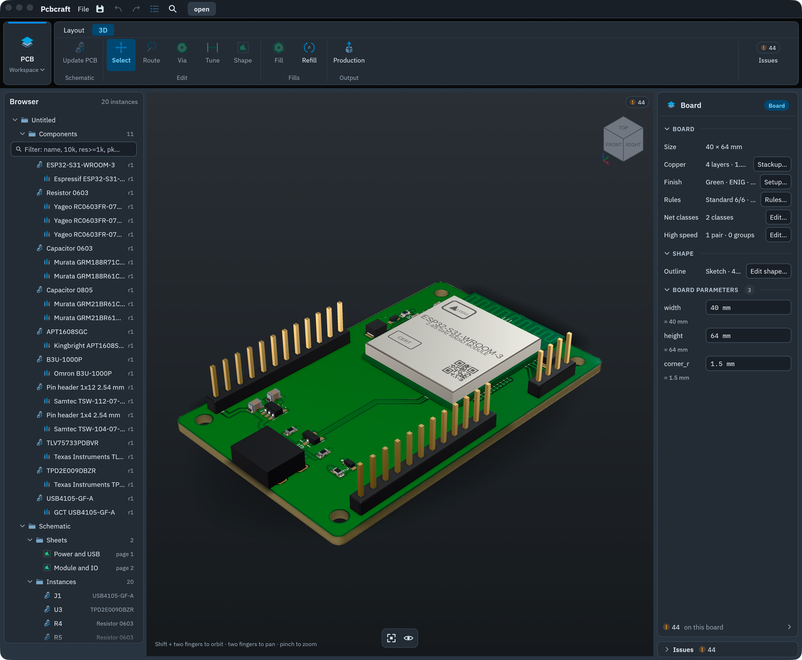
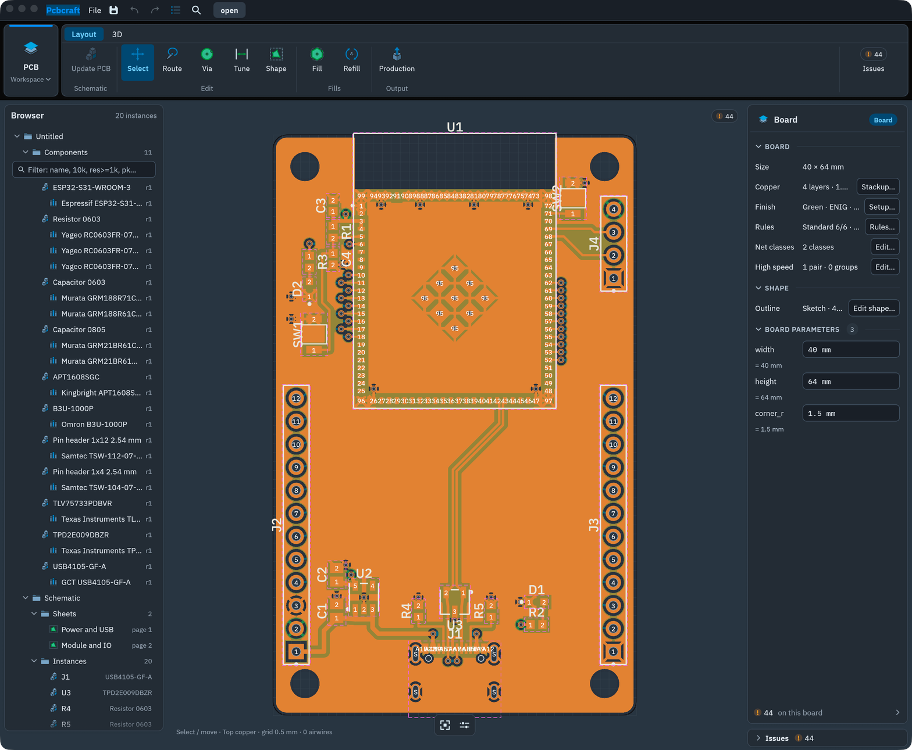

# Pcbcraft

**Parametric PCB design software with deep integrated 3D, built for designers and AI agents alike.**
Parts, schematic, board layout and 3D in one app, on [Solidcraft](https://github.com/tangency-labs/solidcraft)'s CAD engine.

## Why it's different

**Parametric boards.** A board is a design with named parameters and expressions, not a fixed drawing. Width, height and corner radius drive the outline, and placements, fills and keepouts can be tied to its named edges. Footprints are constrained sketches. Part bodies can be parametric Solidcraft models, and common generic parts (chip R, C and L, LEDs, diodes, headers) are made on demand from what you type.

**3D is the same design, not an export.** Copper, pads, plated holes, vias and fills are solids with real thickness, built by Solidcraft's engine. Layout and 3D are two views of one board, with one selection, one undo history and one set of properties. Pick a track in 3D and it is selected in the layout. The whole board saves as a native, parametric `.solidcraft` model.

**Built for AI from the start.** Every change, from a wire to a published part, is a typed command on one engine. The desktop app, the command line and the MCP server send the same commands, and a refused command leaves the design untouched. An assistant can work on a file in the background or, when you allow it, live in the open window, on your undo history. A datasheet assistant drafts parts from PDFs for you to review, on Claude or a local model.

**Already end to end.** Multi-sheet schematics with ERC, push-and-shove routing, differential pairs, length tuning, copper fills, design rules, and production files behind a pre-flight check. Schematic to Gerbers in one app.

## What it does today

<table>
  <tr>
    <td></td>
    <td></td>
  </tr>
</table>

- **Components.** Symbol, footprint, pin functions, mapping and 3D in one workspace. Publishing creates immutable revisions. A project keeps an exact snapshot of its library, so it reopens offline, and a library change reaches a board only through a reviewed update.
- **Schematic.** Several sheets with a hierarchy, net labels, power ports, title blocks, annotation, ERC and vector PDF output. The Place palette searches with units: `res>=10k 0603`.
- **PCB.** 2 to 64 copper layers with a typed stackup. Interactive routing that shoves or walks round other nets. Differential pairs at a gap derived from the stackup's impedance, and length meanders. Design-rule profiles, net classes, copper fills with thermals, and parametric board outlines.
- **3D.** One key from the layout. Peel the stackup layer by layer. Generated part models with markings, and imported STEP, GLB and `.solidcraft` models.
- **Production.** Gerber X2, Excellon, a job file, pick-and-place, BOMs, and fabrication and assembly drawings. Tests read every Gerber layer back and compare it with the design.
- **Automation.** MCP and JSON lines over the same commands as the UI, including live MCP into the open window.

The reference design is a 4-layer [ESP32-S31-WROOM-3 dev board](examples/esp32-s31-devboard/README.md): USB-C, a 90 Ω USB pair, an LDO, 20 parts. An AI agent designed it from parts to Gerbers through the command engine. It passes ERC, DRC and the production check. It has not yet been reviewed or built.

## Where it's going

The goal is one workflow from idea to product: design, simulate, test without hardware, then manufacture. AI drives it end to end, as hands-off as you choose, with every step open to your review. Everything in this section is **planned**, not built.

- **Circuit simulation.** Analog simulation in the style of LTspice, run from the same schematic.
- **The board as a digital twin.** Emulate the microcontroller running your real firmware: for example, an ESP32-S31 running compiled Rust. UART, GPIO, LEDs, displays and buttons work on the 3D board. Press a button in 3D and watch an LED blink. Write and test firmware before the board exists.
- **Smart parts.** Parts that carry electrical and behavioural models next to their symbol, footprint and 3D body, mapped pin by pin, so they simulate both as circuits and in software.
- **Idea to production, AI-driven.** An assistant takes a description to a board: parts from datasheets, schematic, layout, virtual testing and the production files.

Nearer steps, also planned: build and test the ESP32-S31 reference board; drag existing tracks with shove; a realistic render mode; buses and reusable schematic sheets. The [roadmap](ROADMAP.md) tracks the work, and the [product plan](docs/pcbcraft-plan.md) defines the first release.

## Status

Early. It is a working editor, not yet a manufacturing-ready release: no board has been built from its output yet, and the built-in design-rule profiles are estimates. It is developed and tested on macOS (Apple silicon); Linux and Windows have not been checked yet. [Editor evidence](docs/editor-evidence.md) records what was verified and how.

Open source under MIT OR Apache-2.0. The 3D engine, renderer and UI kit come from [Solidcraft](https://github.com/tangency-labs/solidcraft), a parametric CAD application in Rust under the same licences. Its engine builds every solid you see, its native file format holds the 3D model, and its interface conventions shape this one. We are grateful to its authors.

## Quick start

Needs Rust (the toolchain is pinned in `rust-toolchain.toml`) or Nix.

```sh
nix develop    # optional: the pinned toolchain without rustup
cargo run --locked --profile ci -p pcbcraft -- examples/esp32-s31-devboard/esp32-s31-devboard.pcbcraft
```

Open the PCB workspace, press **D** to switch between layout and 3D, and **⌘P** to find any command.

## Documentation

- [Development](docs/development.md): build, checks, crate layout, command line, JSON lines and MCP.
- [Architecture and product plan](docs/pcbcraft-plan.md), and the [component model](docs/component-model.md).
- [MCP and AI integration](docs/llm-integration.md), including [live MCP](docs/development.md#live-mcp) and the [datasheet assistant](docs/datasheet-assistant.md).
- [Keyboard shortcuts](docs/keyboard-shortcuts.md), [push-and-shove routing](docs/push-and-shove.md), [high-speed routing](docs/high-speed-routing.md), [fabrication output](docs/fabrication-output.md).

## Licence and attribution

Licensed under the [MIT License](LICENSE-MIT) or the [Apache License, Version 2.0](LICENSE-APACHE), at your option, like Solidcraft. Third-party notices are in [NOTICE](NOTICE) and [ATTRIBUTION.md](ATTRIBUTION.md).

This is an independent clean-room implementation. It uses public specifications and permissively licensed dependencies, and contains no code or library data from GPL-family or commercial EDA tools. Manufacturer CAD data is used only like a datasheet, with its source and licence recorded.
