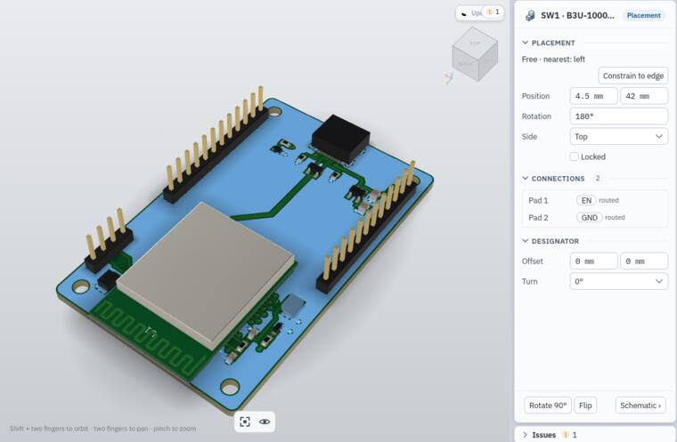
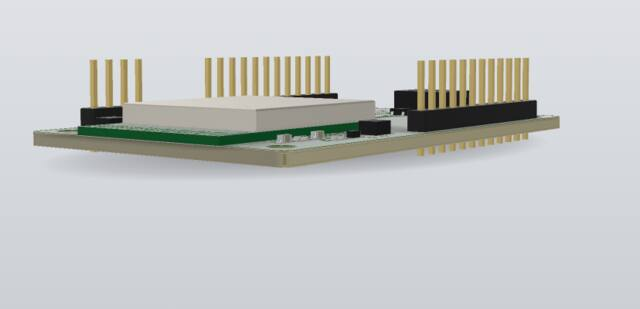
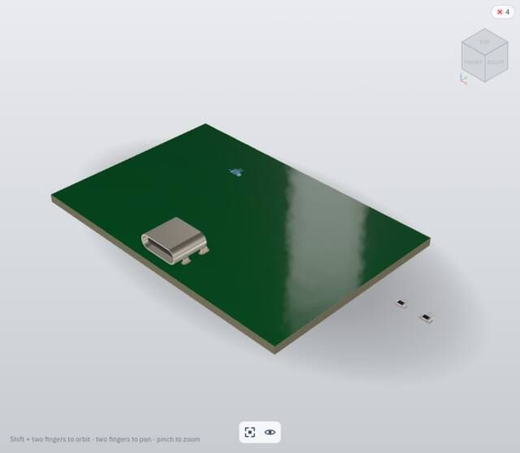
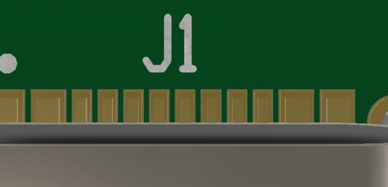
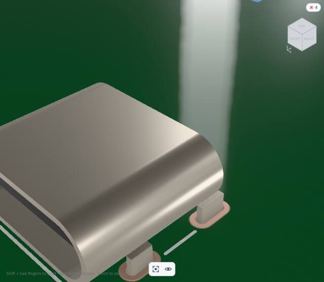
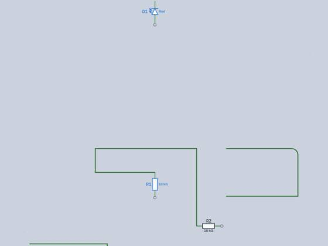
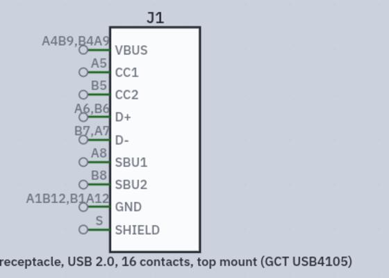

# VM check: SMLib kernel, 3D and the unseen features

On 8 November 2026 an agent checked Pcbcraft in the Herdr macOS VM after the move to Solidcraft's SMLib kernel, and looked for the first time on screen at features merged without a visual check. It worked as a designer would and judged the look as well as the behaviour. Related: the [third run](e2e-run-3.md), [schematic wires](schematic-wires.md), [materials](materials.md).

**Setup.** Build 713244b (`component-model`, which includes the wire arc corners and run 3's minor fixes), `--profile ci`, in a hand-built `Pcbcraft.app`. The VM is macOS 27.2 arm64 with 8 cores and 16 GB, a 1920 × 1200 display at 1×, and a 1380 × 900 app window. The app was driven through the guest driver (`mcp__herdr-vm__*`). Times come from the guest clock and from `ps` CPU time sampled over SSH. No product code was read beyond docs and the gold test, no product code was changed, and no paid API calls were made. Test files and the app instances were removed afterwards, and the recovery folder is empty.

**Driver limits.** These affect what could be checked:
- Shift-click and shift-drag do not reach egui through the driver. Its modifier flags on mouse events are ignored, so shift-click multi-select is **not verified**. Shift and Cmd chords (⇧X, ⌘R, ⌘A) do work.
- Background wheel events zoom about the real pointer, not about the target point. Every zoom was therefore sent in the foreground.
- Typing into native Open and Save panels does not land. Files were opened with `open -a … file`, and saves used the default name.

## Summary: top problems, ranked

1. **3D is far too slow on the new kernel (broken).** Opening the ESP32 board in 3D took **about 3 min 30 s** (02:59:23 to 03:02:57). During that time one core ran at about 110 %, and only the bare board and two parts showed. One **Rotate 90°** on SW1 cost about **3 min 50 s** of CPU (253 s of process CPU time) before the model settled. The same full-board cost comes back on undo. The earlier kernel was estimated at about 5 s for this board ([ESP32 run](e2e-esp32-devboard.md), finding 3). The target is that 3D opens instantly. A small 4-part board opens in about 1 s, so the cost grows with the board. The UI stays responsive meanwhile: orbiting during a rebuild works, and the app's accessibility tree times out.
2. **ENIG pads do not read as gold (ugly).** From the top they are a dark olive bronze, `#7E6D3C`. At an oblique angle they are a rose copper, `#BC9A8D`. Only at some grazing angles is there a pale gold edge. A designer would read most views as "bare copper" or "brass". See [the gold recommendation](#exposed-gold-enig-recommendation).
3. **The mask carries a soft white "smoke" band (ugly).** A vertical streak with ragged edges sits at the same screen position (about x = 730–870) in every view, at every zoom and on both boards. It reads as fog over the board rather than a reflection. Run 3's #24 calls the remaining band the intended mirror image of the studio's strip light, but a gloss lacquer would show a crisper light. At grazing views the main board's mask also turns cream-grey, while the module's own PCB stays green.
4. **The USB-C symbol's pin numbers still collide (ugly; run 3 #10 not fixed).** "A4B9,B4A9", "A6,B6", "B7,A7" and "A1B12,B1A12" run over the pin-end circles and the neighbouring numbers. The long part name runs far past the body.
5. **Generic part from search: one undo does not remove the part.** The first ⌘Z removes the placed instance and leaves the created component in Components. A second ⌘Z removes it. The brief expected one step.
6. **A group rotate leaves an ugly wire.** After ⌘R on a box-selected group, the R1–R2 wire rubber-bands into a U-turn that runs back on itself. The rotated group also lands half outside the sheet frame, with no hint.
7. **Selected vias and pads are hard to see in 3D (hard to find).** A selected tented via shows only a tiny white dot. Clicking a pad in 3D selects its part. That may be intended, but pads can't be picked on their own.

Most other features **work** and look tidy: wire editing with arcs, the context menus, copy and paste, box select with group move, rotate and mirror, generic parts with values, templates in Place and Open, and save and reopen with everything intact.

## 1. New kernel 3D

| Check | Verdict | Notes |
|---|---|---|
| Open time, ESP32 board | **Broken** | About 3 min 30 s, single core. Parts appear only at the end. During the build an "Updating" chip shows and the bare board renders. |
| Part edit to shown, ESP32 | **Broken** | One Rotate 90° gives about 3 min 50 s of CPU. The part shows at once as a translucent stand-in box, and its real body appears minutes later. Undo starts the same rebuild again.  |
| Open time, 4-part board | Works | About 1 s, including a USB-C template. |
| Orbit, pan, zoom | Works | About 17 % CPU while orbiting: no rebuild, and frames look steady (the frame rate can't be read through the driver). Orbit is sensitive: 250 px of right-drag turned the view about 180°. Orbiting from empty space can swing the board out of view. Fit (the AX button; the F key did not reach the canvas from the background) brings it back. |
| Layout and 3D switch | Works | Instant once built. |
| Picking: part, track, via, fill | Works | U1, a USB_DP track, via IO6 and the Inner 1 GND fill all selected in 3D. Selection is shared both ways with Layout: U1 picked in 3D was outlined in 2D, and a fill picked in 2D was highlighted in 3D. |
| Picking: pad | Partly | A pad click selects the part (SW1), not the pad. |
| Selected via visibility | Hard to see | Only a tiny white dot and a short blue stub. |
| Mask colour at every zoom | Mostly works | Green and glossy at overview and mid zoom. Close up, the "smoke" band and wide sheen areas wash it to grey-green (`#606C5E`). At grazing views the main board turns cream-beige while the module PCB stays green.  |
| Mask sheen or haze | Ugly | See top problem 3.  |
| Copper, tracks under the mask | Works | Tracks read as raised lines under the lacquer. Vias are tented. |
| Silkscreen | Ugly | It reads mid-grey (`#9A9F9A`) with a mottled texture, not white ink.  |
| ESP32 module instanced parts | Works | The shield can, the module PCB with its antenna meander, and the module's passives all look right. The can's laser marking ("ESP32-S31-WROOM-3", QR code) is legible close up but almost invisible at overview. It shows clearly in the selection tint, so the contrast is low rather than missing. |
| Header pins (hard gold) | Acceptable | Pale yellow, a little flat. |
| USB-C 3D | Works | A convincing stainless shell with legs in the slots. |
| LED 3D | Works | A white lens body, terminations and gold land edges. |

### Exposed gold (ENIG): recommendation

**What a designer sees.** The pads are the same material in every view, but they read differently. From the top they are dark olive bronze (`#7E6D3C`). Its linear hue is right for gold (G/R ≈ 0.73, B/R ≈ 0.21), but it is dim, because the reflection direction finds a dark part of the studio. At an oblique angle they are rose copper (`#BC9A8D`, B/R ≈ 0.52), washed out by a grey reflection. At grazing angles the pad edges show a pale gold. Real ENIG photographed under soft light reads as a light, clearly yellow gold from most angles. Here most views read as copper or brass. 

**Is "the brightest of 8 views ≥ 0.30" a physical expectation? Not on its own.** For a metal, the pixel is about F0 × (prefiltered studio radiance in the reflected direction). Gold's F0 luminance is about 0.76 (F0 (1.0, 0.73, 0.30)), so a mean of 0.30 needs the pads to reflect a studio region of about 0.40 radiance on average. That is a property of the studio and the camera, not of the gold. The new studio gives 0.17, 0.21 and 0.24 (lowest, median, brightest), which means it is about 0.3 radiance where the pads look. The bar mixes two claims: "the material is gold" and "the studio puts a light where a typical view's pads reflect it".

**Recommendation.** Split it into two tests and restate both:
1. **Material test, independent of the studio.** Render the pads, then render the same pads with a neutral reference metal (F0 0.95 grey, same roughness) from the same 8 views. Assert that the gold-to-reference luminance ratio is close to 0.76 / 0.95 ≈ 0.8 (±0.1). Assert that the mean linear chromaticity of the pad pixels is within tolerance of gold's F0 (G/R 0.73 ± 0.08, B/R 0.30 ± 0.10) in, say, at least 6 of 8 views. That catches "brass", "khaki" and "rose" regressions whatever the studio does. The rose oblique view here would fail it.
2. **Look test, owned by the studio.** Keep "never black" (lowest ≥ 0.10). Replace the absolute 0.30 bar with "at least one of the 8 views shows a highlight": its 95th-percentile pad luminance is ≥ 0.5, and it does not clip. Label the threshold an art-direction target, not physics. If the founder wants pads to look gold from the default and top views, as in product shots, the fix belongs in the studio (a soft overhead key or a ring-light term near the camera), not in a brighter F0 or lower roughness.

With those two tests, the current renderer would probably pass test 1's ratio, fail its hue clause on the oblique views, and fail test 2. That matches what is seen on screen.

## 2. Right-click menus

| Target | Verdict | Items |
|---|---|---|
| Empty sheet | Works, pretty | Place part P, Wire W, Label L, Paste ⌘V (dimmed when empty), Fit view F. Power, junction and no-connect are not offered. |
| Symbol (U3) | Works | Rotate ⌘R, Mirror ⇧X, Edit component, No connect on all open pins (dimmed when none are open), Delete… (red). **No Cut, Copy or Duplicate.** |
| Power port (GND) | Works | Edit, Rotate, Delete. The card's button says **Remove** while the menu says **Delete**. |
| Wire | Sparse | Add junction here, Delete…. The card says **Disconnect wire…**. There is no Add corner, Split here, Round corner or Label net. |
| Browser instance row | Works (run 3 #21 fixed) | Select, Locate, Edit component, Delete…. |
| Browser folder row (Instances) | Works (run 3 #21 fixed) | Place part, Annotate. |

Menus fade in, show their keys from the registry and close on Esc.

## 3. Copy and paste in the schematic

**Works.** ⌘C on R1, D1 and a wire, then ⌘V, pastes R3, D2 and the wire at the pointer, renumbered and left selected, as one undo step. The paste can land on the title block, with no nudge away from it (minor).

## 4. Multi-select

| Check | Verdict |
|---|---|
| Box select (left to right, enclosed) | Works: "3 objects · 2 symbols, 1 wire", with Remove, Mirror and Rotate on the card. |
| ⌘A | Works: 8 objects. |
| Shift-click or shift-box to add | **Not verified** (driver limit above). |
| Group move | Works. Wires inside move whole, and the wire to R2 rubber-bands. |
| Group rotate ⌘R | Works, but ugly: a U-turn wire, and the group leaves the sheet frame.  |
| Group mirror ⇧X | Works. |
| Undo of each | Works, one step each. |

Esc with a selection does not clear it; it only closes menus. That may be intended.

## 5. Wire editing

| Check | Verdict |
|---|---|
| Draw pin to pin with a corner | Works. The 90° elbow is horizontal first, with a "Drew the wire · Undo" toast. |
| Start in empty space; double-click ends with a free end | Works. |
| Esc ends at the last fixed point; Esc with nothing fixed cancels; a third Esc returns to Select | Works. |
| Backspace removes the last corner | Works. |
| Join two free ends | Works. A snap ring shows on the target, and the result is one path, "Free end → Free end". ERC warnings went 6 → 4. |
| One click selects the whole path | Works. It shows squares at corners and free ends and dots at midpoints, with the hint "Drag reshapes · double-click adds or drops a corner · ⇧Delete splits". |
| Drag a corner | Works. Both segments keep their direction. |
| Drag a segment | Works. |
| Insert a corner (double-click a segment) | Works. The corner is picked and the card shows Radius 0 mm. |
| Remove a corner (double-click a corner) | Works. |
| Rubber-band on part move | Works. |
| Delete or Backspace on a selected wire | Works (run 3 #7 fixed): it opens the Disconnect wire review, and Esc closes it. |
| Free ends unselected | Hard to see. A free end has no marker until the wire is selected. ERC lists it. |
| Arc: A in the Wire tool | Works. New corners are rounded at 2.5 mm, and the card shows "Arc (A)" ticked. |
| Arc: A on a selected corner | Works. It toggles sharp and round. |
| Arc: drag the arc dot | Works. 2.5 mm became 16.5 mm, limited to fit. At a small radius the dot sits on the corner square and is hard to grab. After the drag no corner is picked, so the Radius row disappears until the corner is clicked again. |
| Arc: Radius field | Works. Typing 5 mm applied at once. |
| Save and reopen with arcs | Works. The file holds `"radius": 2.5` on two corners, and the arcs redraw after reopening. |

## 6. Templates from Open and Place

**Works.** In Place, "usb" lists a "From template" group (the GCT USB4105 row and a custom row) with Create buttons. In the Component workspace's Open page, "header 2x5" lists "Generic parts" and "From template" groups. Minor: the USB4105 row says "16 contacts" while its card says "Terminals 13"; the merged A and B duplicates explain it, but nothing says so.

## 7. Generic parts on demand

| Check | Verdict |
|---|---|
| "header 1x13" | Works. One row "Pin header 1×13 2.54 mm" with the badges `not yet created`, `rows × columns` and `2.54 mm (default)`. Enter creates it and arms placement. |
| "10k 0603" | Works, **and the value is set**: the instance title is "R1 · 10 kΩ" and Resistance is 10 kΩ. The badges are `imperial`, `1.6 × 0.8 mm` and `10 kΩ`. A second search finds it "In this project" instead of building it again. |
| "led 0603 red" | Works. Colour is Red and shows under the symbol. |
| One undo removes the part | **Broken against the brief.** It takes two undos (instance, then component). |
| Card wording | Minor. The created header's card says "Custom values edited from package template row 'Pin header 1×1 2.54 mm' … verify agains…": it names a 1×1 row, and the text is cut short. |
| Stale toast | Minor. "Created …: click the sheet to place it, Esc to cancel" stays up after the part is placed. |

## 8. USB-C and LED templates

| Check | Verdict |
|---|---|
| USB-C footprint | Works. 12 signal lands, 4 slotted shield pads, 2 non-plated pegs, a pin 1 dot and a silk outline. Pad numbers are hidden where they don't fit (run 3 #11). |
| USB-C 3D | Works. |
| USB-C symbol | Ugly (top problem 4).  |
| LED footprint and 3D | Works. Two lands, a cathode mark, and the 3D body on its lands. |
| LED symbol | Works. Emission arrows, with "Red" as the value. |

## 9. Run 3 fixes rechecked

| # | Status in the doc | Seen in the VM |
|---|---|---|
| 1 Enter makes the wrong size | Fixed | **Fixed.** "header 1x4" puts the generic 1×4 first and highlighted; the 1×40 template comes after. |
| 2 Passives have no value field | Fixed | **Fixed** (see item 7). |
| 6 Esc doesn't close menus or reviews | Fixed | **Fixed.** Esc closed every context menu and the Disconnect review. |
| 7 Delete on a wire does nothing | Fixed | **Fixed.** It opens the review. The naming still differs: Disconnect wire… on the card, Delete… in the menu. |
| 10 USB-C pin text collides | Fixed | **Not fixed.** See top problem 4. |
| 14 First ⇧⌘U does nothing | Not fixed | The first press worked this time. The review said "4 parts staged" and "Adds 4 placements". |
| 16 Export needs a folder | Fixed | **Fixed.** The card says "Choose a folder to save to, then Export". |
| 19 Settings icon and half-cut row | Fixed | **Fixed.** Gear icon, and the card runs to the screen edge. "Command palette" is listed twice (⌘P and ⇧⌘P), which is confusing. |
| 20 Nets count differs | Founder decision | Unchanged: the sheet card says Nets 1 and the Browser says 14. |
| 21 Browser row menus | Fixed | **Fixed** (item 2). |
| 23 Fit button on the title block | Fixed | **Fixed.** The sheet ends above the navigation bar. |
| 24 3D haze | "Not a defect now" | **Still reads as haze** (top problem 3). |
| 3, 4, 5, 8, 9, 11, 12, 13, 17, 18, 22 | Fixed | Not rechecked by hand, except #11, which looked right on the USB-C footprint. |

## 10. Saving

| Check | Verdict |
|---|---|
| ESP32 board: edit, save, quit, reopen | **Works.** The saved file was compared on the host with the shipped example: instances 20, wires 133, placements 20, **tracks 201**, vias 55, fills 4 and labels 133 are all identical. Only the edited sheet name differs. The earlier loss of traces did not recur. |
| New project: save, quit, reopen | Works. 4 instances and 4 wires, with free ends and arc radii intact. It reopens in the PCB workspace, not the Schematic it was saved from (minor). |
| Dirty marker after undo | Works. "•" clears when undo returns to the saved state, both after the ESP32 rotation and after undoing a generic part twice. |
| Quit with changes | Works. "Save changes before quitting?" with Cancel, Don't Save and Save. |
| ⌘N toast | Minor. A new project says "Opened Untitled". |
| Native Open panel | Minor. The in-app File menu stays drawn open behind the native panel and after it closes, until Esc. |

## Other observations

- The 3D card for U1 has an empty Designator section.
- In 3D, rotating SW1 raised one warning, which was not looked into. The overlay's warning chip covers the "Updating" chip at the top right (visible in the stand-in screenshot).
- The 3D fit leaves the board low in the frame, with empty space above.

## Fixed afterwards

Checked by headless tests only; none of these was retried in the app.

- **Top problem 4, USB-C pin numbers (run 3 #10). Fixed in symbol drawing, for every symbol.** A pin number now fits along its stub: as it is, else up to a quarter smaller, else stacked pads take a short form, the first pad and "…" ("A4B9…", "A1B12…"), smaller as needed. It never runs past the pin end. The full designations stay in the pin mapping. A value wider than the body (the receptacle's long name) wraps at spaces to the body's width (`usb_c_pin_numbers_sit_clear_and_the_value_wraps` checks that no number box touches the end ring, another number or a name, and that the value fits the body).
- **Top problem 5, two undos for a generic part. Fixed.** The first placement of a part that search or a template has just created joins the create (`Engine::join_last_step`), so one undo takes back both. Later placements are steps of their own. Esc before placing still undoes the create (`creating_and_placing_a_generic_part_is_one_undo_step`, `a_joined_step_undoes_with_the_one_before`).
- **Top problem 6, group rotate. Fixed.** A rubber-banded wire that a move would make double back (a U-turn, or a segment straight back over the one before) is drawn again as one step, keeping the direction it had at the end that stayed. A U-turn the wire already had is kept. ⌘R on a group turns it about its middle, moved by whole grid steps so a group inside the sheet's frame lands inside it again where it fits; a group already off the sheet is not pulled onto it (`arrange::turn_about`; `a_turned_group_leaves_no_u_turn`, `a_turned_group_stays_inside_the_sheet_frame`).
- **Top problem 7, 3D picking. Fixed.** A selected object smaller than 24 points on screen, such as a via or a small pad, gets a ring in the selection colour around it, so it reads as selected at overview zoom and under the mask (`a_small_selected_via_gets_a_ring`). Pad-level selection is not intended: in Layout a pad click selects its part and lights the pad's net. 3D now goes through the same selection code (`PcbEditor::select_picked`), so a 3D pad pick does the same (`a_3d_pick_selects_as_a_layout_click`).
