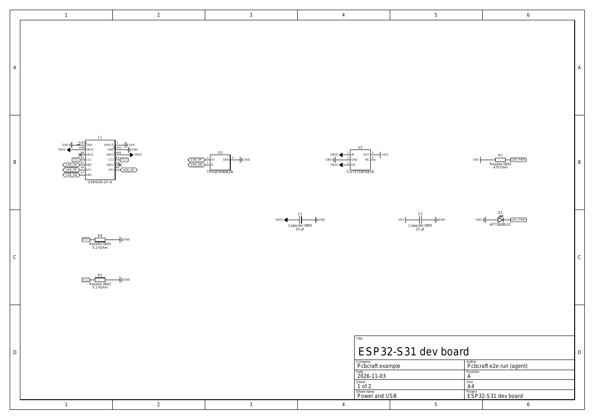
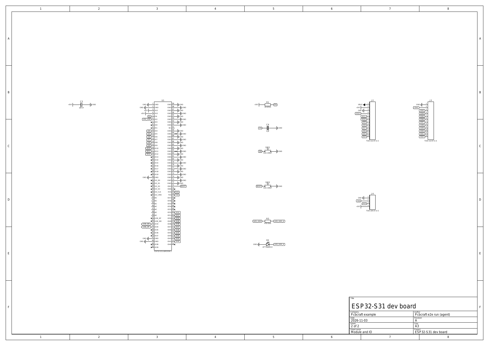
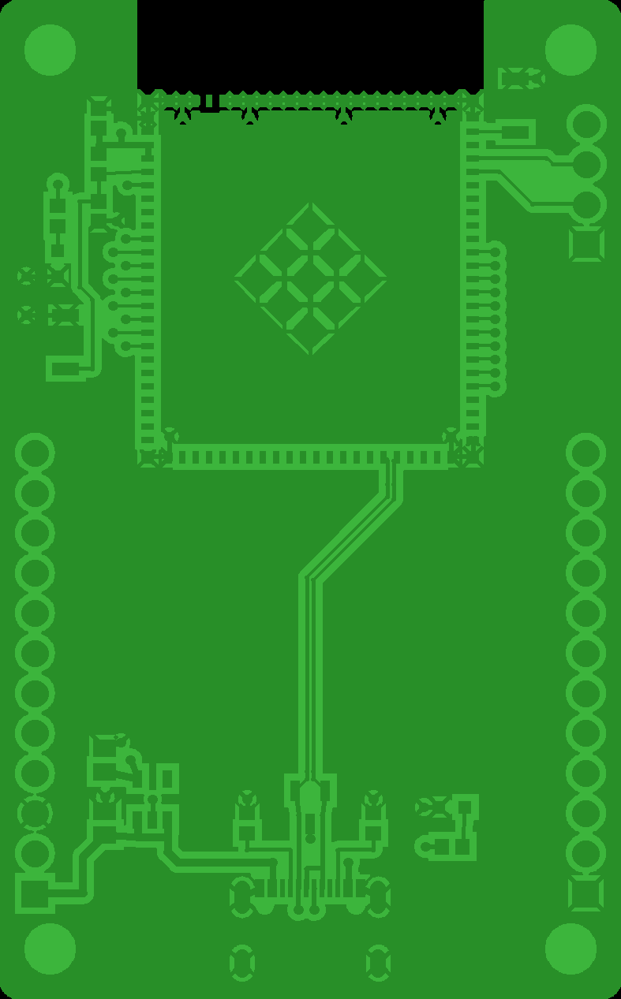
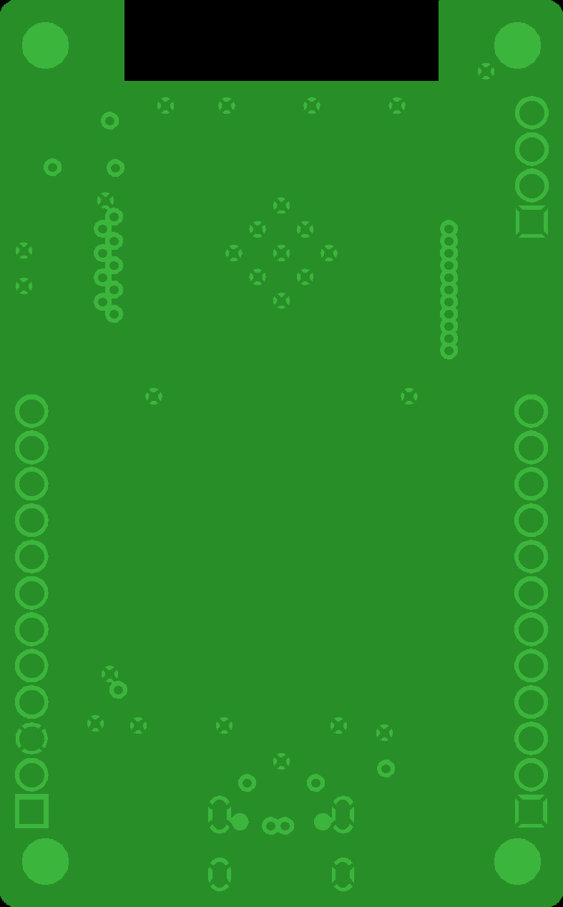
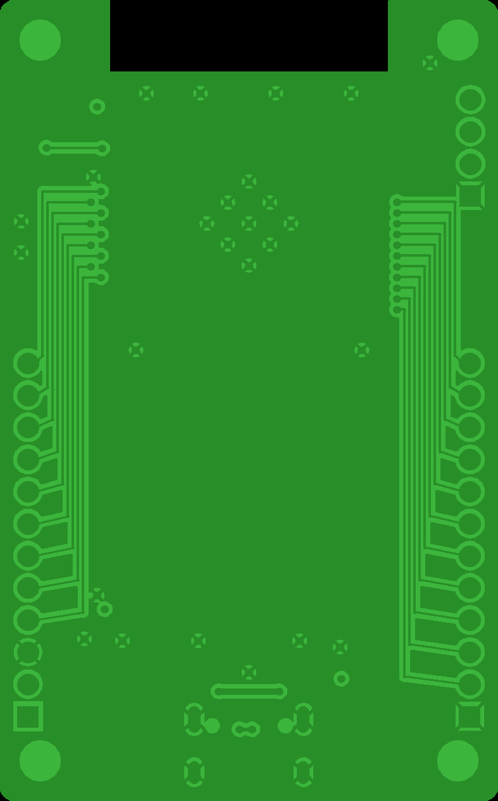
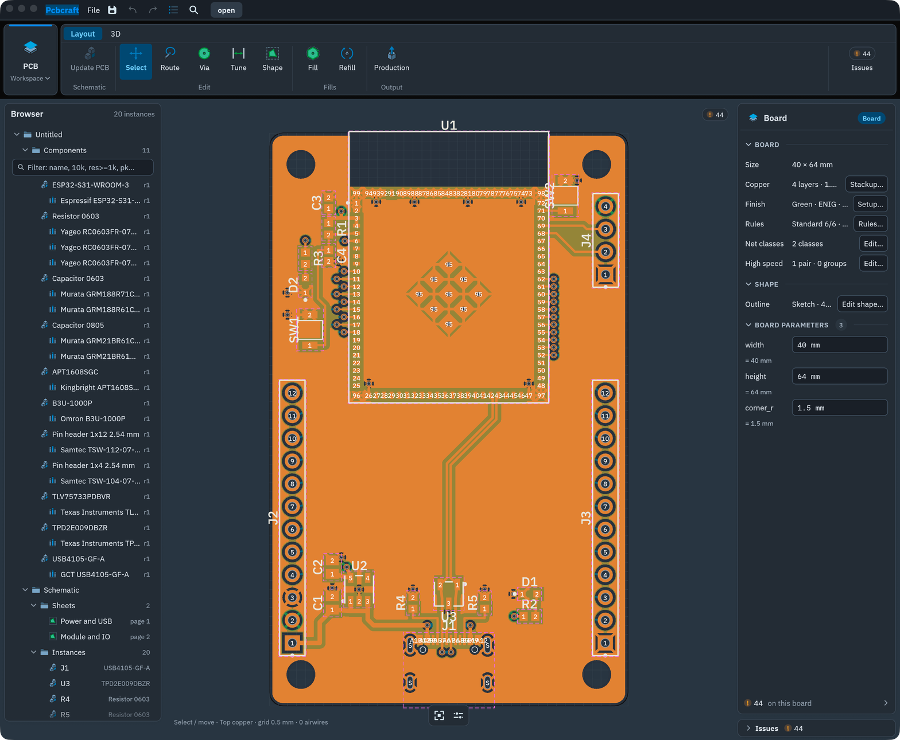
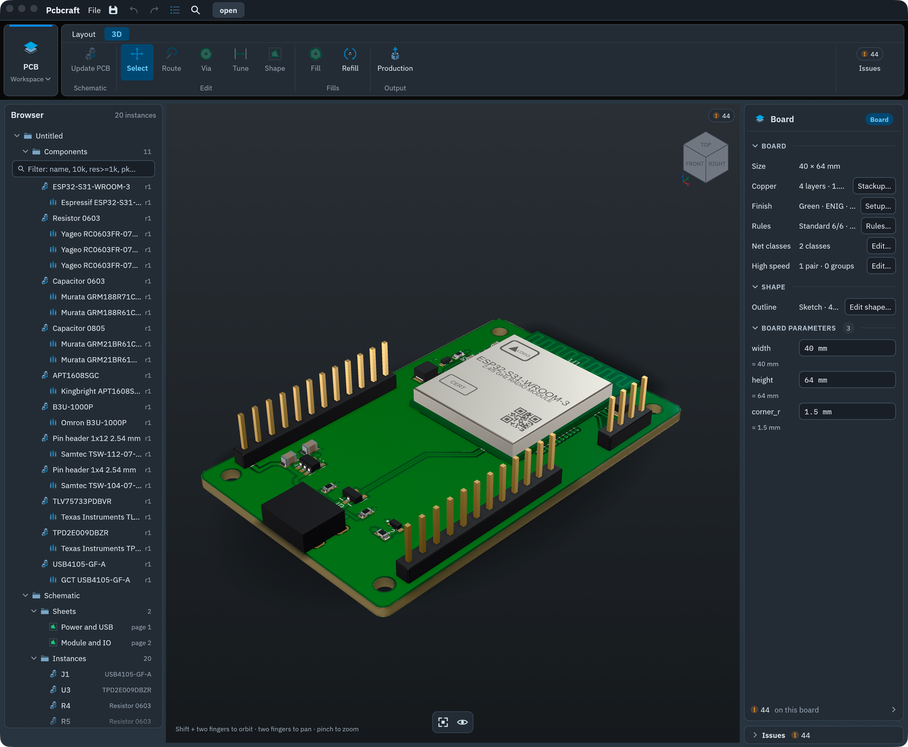

# ESP32-S31 dev board (end-to-end acceptance board)

Release plan step 5: a real ESP32-S31-WROOM-3 development board designed from components to Gerbers through Pcbcraft's own command engine, as a CLI/MCP client would. The run, its friction and its gaps are in [docs/e2e-esp32-devboard.md](../../docs/e2e-esp32-devboard.md).

**Status: an unreviewed design.** It passes Pcbcraft's ERC, DRC and production check, and the outputs were cross-checked by an independent Gerber parser. No person has reviewed it, and no board has been built. Several limits are listed below. Do not order it unreviewed.

## Files

| File | What |
|---|---|
| `esp32-s31-devboard.pcbcraft` | The project. Open it in the desktop app. It holds the parts library, two schematic sheets, the 4-layer board, the fills and the waiver-free production state. |
| `esp32-s31-devboard.replay.jsonl` | The full command sequence: 583 JSON-lines requests through `pcbcraft-cli stdio --operator`. It replays to a byte-identical `project.json`. |
| `regenerate.sh` | Replays the board and writes `fab/` and the schematic PDF. With `NATIVE=1` it also writes the `.solidcraft` model (about 10 s of CPU). |
| `fab/` | Gerber X2 for 4 copper layers, masks, top paste, top legend and profile; plated and non-plated Excellon; drill map and table; job file; top pick-and-place; both BOMs; fabrication and assembly PDFs. |
| `esp32-s31-devboard-schematic.pdf` | The schematic, two sheets. |
| `authoring/` | The Python client that wrote the replay: placement coordinates, routes and part data with their datasheet sources. It is not application code. `python3 -B examples/esp32-s31-devboard/authoring/build.py route` from the repository root re-records the replay. |
| `parts/b3u-1000p.solidcraft` | The switches' 3D model: original work (MIT OR Apache-2.0), authored through Solidcraft's commands by `cargo test -p pcbcraft-solidcraft --test author_parts -- --ignored`. `pcbcraft-cli part check` checks it. |
| `parts/usb4105.solidcraft` | J1's 3D model, authored the same way: a nickel shell with a stadium (racetrack) cross-section, sketched and extruded, open at the mating face, with its four stakes; the LCP insulator closing its rear and the round-cornered tongue centred in the opening; the twelve gold solder tails of the rear row. The board holds J1 by its shell's front face (`F2:start`, the extrusion's start face): two part dimensions keep that face on the bottom edge and J1's origin at `width / 2` from the left edge, so J1 follows a change of the board's width. |
| `images/` | Schematic pages; copper layers rendered by PyGerber (MIT) from the Gerber files; desktop screenshots of PCB 2D and 3D. |

```sh
cargo build --locked --profile ci -p pcbcraft-cli        # or inside nix develop
sh examples/esp32-s31-devboard/regenerate.sh
```

## Board

- **Size:** 40 × 64 mm, 1.5 mm corner radius, four M2.5 mounting holes (2.7 mm NPTH, board-level holes), each `inset` (3.5 mm) from its two nearest edges, so the sketch is fully defined and the holes follow a width or height change.
- **Stackup:** 4 layers, 1.74 mm. From the top: signal, prepreg 0.2 mm (2116), GND plane, core 1.2 mm (7628), 3V3 plane, prepreg 0.2 mm, signal. Both inner foils are marked as reference planes. The Dk values are Pcbcraft's generic estimates.
- **Rules:** the profile file [`examples/profiles/jlcpcb-4-layer-1oz.json`](../profiles/jlcpcb-4-layer-1oz.json), written from JLCPCB's [PCB capabilities page](https://jlcpcb.com/capabilities/pcb-capabilities) (read 2026-11-11; every rule cites its row). Overrides: copper (track, pad, via, fill) to board edge 0.3 mm and legend to edge 0.2 mm (JLCPCB publishes no legend-to-edge limit).
- **Net classes:**
  - Power (GND, +3V3, VBUS): 0.5 mm tracks, 0.3 mm minimum.
  - USB: 90 Ω differential. On top this derives a 0.266 mm width and a 0.152 mm gap, as microstrip over the GND plane.
- **Fills:** each follows the board outline (`region: board`), so changing `width`, `height` or `corner_r` on the Board card moves the pours with the board; a refill fills the new outline.
  - GND on Inner 1 and on Bottom.
  - +3V3 on Inner 2.
  - GND on Top, with a 0.4 mm fill clearance so the USB pair stays a microstrip.
  - The module's antenna keep-out (from its footprint) keeps copper off all four layers under the antenna, which sits at the board edge.

## Circuit and parts

| Ref | Part | Manufacturer | Why |
|---|---|---|---|
| U1 | ESP32-S31-WROOM-3 | Espressif | The module (`examples/esp32-s31-wroom-3`, published here) |
| U2 | TLV75733PDBVR | Texas Instruments | 3.3 V LDO for 1 A. The module needs at least 0.6 A from its supply (datasheet v0.7, Table 6-2). The dropout at 1 A is about 0.4 V, which fits 5 V to 3.3 V. |
| U3 | TPD2E009DBZR | Texas Instruments | 2-channel ESD protection on D+ and D−, 0.9 pF |
| J1 | USB4105-GF-A | GCT | USB-C receptacle for USB 2.0, with both plug orientations joined |
| R4, R5 | RC0603FR-075K1L (5.1 kΩ) | Yageo | CC1/CC2 pull-downs (sink role) |
| C1 | GRM21BR61C106KE15L (10 µF 16 V) | Murata | LDO input |
| C2 | GRM21BR61A226ME51L (22 µF 10 V) | Murata | 3V3 bulk, per the module's peripheral schematic (22 µF + 0.1 µF) |
| C3 | GRM188R71C104KA01D (100 nF 16 V) | Murata | Decoupling at module pins 3 and 4 |
| R1, C4 | RC0603FR-0710KL (10 kΩ), GRM188R61C105KA93D (1 µF) | Yageo, Murata | EN RC delay. The module datasheet recommends R = 10 kΩ and C = 1 µF. |
| SW1, SW2 | B3U-1000P | Omron | RESET (EN to GND) and BOOT (IO61 to GND). IO61 low with IO60 high (internal pull-up) selects joint download boot, Table 4-3. |
| D1, D2 | APT1608SGC | Kingbright | Power LED on 3V3 and user LED on IO2, each through 470 Ω (RC0603FR-07470RL) |
| J2, J3 | TSW-112-07-G-S | Samtec | GPIO breakout. J2: VBUS, 3V3, GND, IO12…IO4. J3: GND, IO42…IO52. |
| J4 | TSW-104-07-G-S | Samtec | UART0: GND, TX0, RX0, 3V3 |

The BOM (`fab/esp32-s31-devboard-bom.csv`) has 15 lines and 20 parts, every line resolved to a manufacturer Part.

The USB-C port goes to the module's **USB Serial/JTAG** pins: IO34 (D+, pin 43) and IO33 (D−, pin 42). The ROM uses this path for download and console. The High-Speed OTG pins (40 and 41) are left unconnected. The 30 unused module IOs and the receptacle's SBU pins are marked no-connect.

### Sources

The values come from manufacturers' public datasheets, used as datasheets. None of these files is redistributed here:

- Espressif:
  - ESP32-S31-WROOM-3 datasheet v0.7: pins, supply, EN RC, strapping, peripheral schematic.
  - ESP32-S31 chip datasheet v0.5: USB Serial/JTAG on GPIO33/34.
- TI:
  - TLV757P (SBVS320/322): pinout, DBV0005A land pattern 0.6 × 1.1 mm.
  - TPD2E009: pinout, DBZ0003A land pattern 0.6 × 1.3 mm.
- GCT: USB4105 drawing (rev B4, <https://gct.co/files/drawings/usb4105.pdf>), Recommended PCB Layout, and these values for the receptacle's part file: the outline (8.94 × 7.35 × 3.31 mm) and the 8.34 × 2.56 mm opening 1.73 mm up, from which the 0.30 mm shell and its stadium section follow; the stakes 2.60 mm and 2.60 + 4.18 mm from the mating face, the front ones 1.10 mm long; the tails' x positions (0.5 mm pitch, VBUS at ±2.40 mm, GND at ±3.20 mm) and widths (0.20 mm signal, 0.45 mm shared). Illustrative: the cavity depth, the tongue (6.7 × 0.7 mm, 0.6 mm behind the face, 0.3 mm corners), the rear stakes' length (the front ones'), and the tails' thickness, reach and run under the shell. The stakes are drawn above the seating plane only. GCT's STEP model for the USB4105-GF-A was not used: gct.co serves its model downloads behind a browser check that refused a scripted download, so the shape follows the drawing alone.
- Omron: B3U catalog, PCB pad and the B3U-1000P(M) dimensions (p.2) for the switch's part file: housing 3 × 2.5 mm, 1.2 mm to the cover, 1.6 mm over the 1.5 mm plunger, 4 mm over the 1.4 mm wide terminals. The drawing gives no cover or terminal thickness; the part file's 0.1 and 0.15 mm are illustrative.
- Kingbright: APT1608SGC, recommended soldering pattern; pad 1 is the cathode.
- Murata and Yageo: MPNs and ratings from the product series pages. The capacitor and resistor lands are Pcbcraft's starter-table estimates.
- Samtec: TSW. The header footprint is Pcbcraft's 2.54 mm header template.

No EDA tool's library or code was used, and no vendor CAD file was used. The module's own Espressif CAD cross-check is described in its example.

## Images

Schematic (sheet 1: power and USB; sheet 2: module and IO):




Copper, rendered from the Gerber files by PyGerber 2.4.3 (MIT), an independent parser. In order: top, Inner 1 (GND), Inner 2 (3V3), bottom.






The board in the desktop app: PCB 2D (top copper and the top pour; 0 airwires), and the integrated 3D view:




## Design notes and known limits

- **USB pair.** It runs from the ESD diodes to the module as one coupled 90 Ω pair on top, routed by `layout.route_pair`. Between the receptacle and the ESD diodes the halves run 1.5 mm apart.
  - The plug orientations are joined at the receptacle: A6 to B6 by a short top track, and A7 to B7 by two vias and a bottom track under the receptacle. The vias are tented, under the connector body.
  - The pair check measures each half along its signal path, J1.B6 to U1.43 and J1.B7 to U1.42: 29.865 mm each, so the skew is 0. The length report lists the plug-orientation joins as stubs: 2.245 mm to J1.A6 and 6.98 mm to J1.A7. See the log.
- **GPIO buses.** They run on the bottom layer, so no part sits in their way. The header order follows the module's pin order (J2 pin 4 = IO12 … pin 12 = IO4), so the buses route without crossings.
- **EPAD.** Each of its nine squares has a via to the GND plane. The datasheet makes soldering the EPAD optional and recommends a moderate amount of paste. The paste follows the footprint's default.
- **3D models.** The module uses its parametric part file. The passives, the LEDs (the chip-LED row, from the Kingbright drawing), the SOT parts and the headers use generated models. The USB-C receptacle uses the example's `parts/usb4105.solidcraft`, and the two switches use the example's own part file, `parts/b3u-1000p.solidcraft`: a parametric Solidcraft design (housing, metal cover, plunger and terminals) whose defaults are the B3U-1000P drawing's dimensions. The production check has no warnings.
- **Legend.** U1's footprint outline passes the top edge by 0.225 mm at the antenna end; the fabricator trims those lines (the production check covers legend text, not lines). J2's and U1's designators are moved onto the board with `instance.set_text_placement`. The switch footprint prints its designator outside the body outline, on the side away from SW2's neighbour U1, whose pads its old spot touched. The desktop screenshots in `images/` were taken before those moves.
- **Antenna.** The module's edge is at the board edge. Espressif's guidelines ask for about 15 mm of clearance around the antenna on the host side, beyond the keep-out. The board leaves the keep-out area empty on every layer, but it does not extend past the module.
